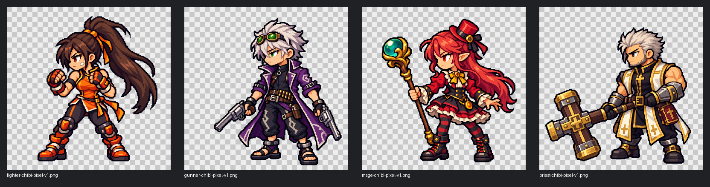

# Chibi pixel roster concepts

## Playable roster

All five classes now use the shared pixel-art renderer. See [gameplay demo](gameplay-demo.md) for included actions, equipment, verification and remaining limitations. Earlier concept-only review notes below are historical.

## Latest correction: separate bodies from weapons

Next production work is defined in the [gameplay animation asset plan](animation-assets.md): current action coverage, separate weapon/projectile/effect assets, provisional frame budgets and a small equipment-swap proof before the full batch. No animation assets have been generated yet.

The user's Mage and Priest references supersede the initial designs below. [Corrected empty-hand bases and the equipment art contract](character-equipment.md) are now the production direction for those classes. Weapons and held books must be separate assets for all classes. The images below remain exploration history, not final weapon-bound character designs.

Generated on 2026-10-28 with built-in `image_gen.imagegen`, matching the approved [Slayer v6](../slayer/chibi-pixel-reference-v6.md) as the visual reference. This extends the selected art direction to the other four existing classes.

| Class | Variant | Appearance cues | Project weapon |
| --- | --- | --- | --- |
| Gunner | Male | White hair, green goggles, purple split coat, cartridge belt, sandals | Dual pistols |
| Fighter | Female | Dark ponytail, orange-and-black athletic outfit, protective gloves and boots | Fists |
| Mage | Female | Red hair, pointed ears, small black hat, black pinstriped coat, red-black layers, short red-cuffed boots | Staff in current prototype; separate equipment |
| Priest | Male | Dark brown hair/beard, asymmetric white-and-black sleeves, long dark coat, gold pendant | Cross in current prototype; separate equipment |

These classic gender variants were selected as an assumption; the current class resources do not define gender. No gender selection or additional classes were added.

## References and generation

Official class pages: [Male Gunner](https://www.dfoneople.com/gameinfo/character/Gunner%28M%29), [Female Fighter](https://www.dfoneople.com/gameinfo/character/Fighter%28F%29), [Female Mage](https://www.dfoneople.com/gameinfo/character/Mage%28F%29), [Male Priest](https://www.dfoneople.com/gameinfo/character/Priest%28M%29).

Appearance notes were informed by original class artwork found through image search. Only Slayer v6 was supplied as a local visual reference to generation. These are adaptations, not exact reproductions of the original costumes. Priest's cross follows the existing project weapon rather than the hammer seen in base-class portrait art.

Full prompts and source page links are recorded in [manifest.json](manifest.json). Source generated PNGs are preserved unchanged with embedded metadata. No downloaded original artwork is bundled.

## Review status

All four concepts await user review. They share the selected chibi proportions and pixel-inspired shading, with different class silhouettes. The comparison sheet uses nearest-neighbor scaling.

[QA report](qa-report.json) confirms PNG dimensions and non-opaque alpha in all four files. This check does not establish production pixel-grid accuracy, exact original-design fidelity or animation readiness.

Final game dimensions remain undecided. Consistent pixel grid, palette cleanup, padded bounds, weapon pivots and animation frames need verification at gameplay scale. No in-engine review performed. `.gdignore` excludes concepts from imports. Runtime unchanged.
