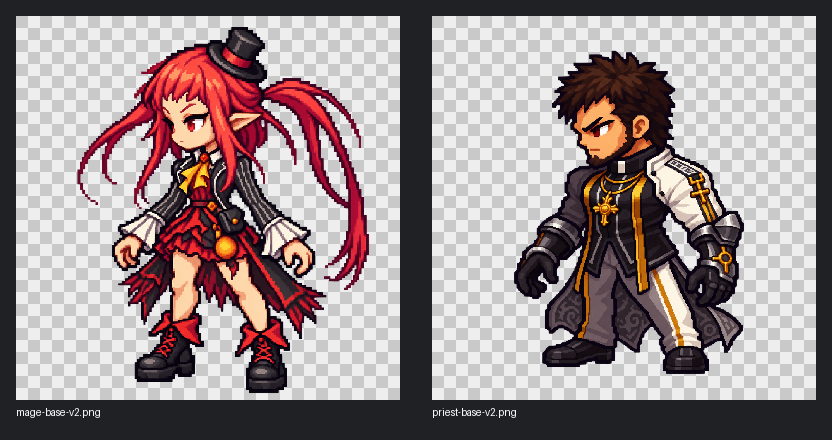

# Character bodies and interchangeable equipment

## Art contract

Applies to all five classes. Character identity belongs to the body: hair, face, costume, class-specific anatomy and proportions. Held weapons and equipment are separate assets. The original artwork's weapon is an example loadout, not a permanent part of class appearance.

- Keep body sprites free of held weapons, carried books and back-mounted equipment.
- Author weapon sprites separately with a defined grip point. Offhand books/shields are equipment too.
- Author per-frame left/right hand anchors and front/back layer order with body animation; do not infer anchors from concept PNG coordinates.
- Two-handed weapons need primary and secondary grip alignment. If the grip cannot fit a reused pose, author a suitable pose.
- Use grip and attack families appropriate to the chosen weapon. A weapon swap may reuse body identity but still require different arm poses and animation.
- Keep body frames on one pixel grid, foot baseline and stable origin. Transparent canvas bounds are not the character's actual game size.
- Preserve asymmetric anatomy and clothing in both facings. Slayer's cursed arm remains anatomically left; Priest's white sleeve remains anatomically left. Simple whole-sprite mirroring would swap them.

These requirements describe the asset pipeline. They do not define weapon eligibility, equipment rules or new combat behavior; those decisions remain open. No equipment runtime is implemented by these concept changes.

## Corrected reference targets

The user's supplied Mage and Priest artwork supersedes the earlier appearance notes.

**Mage:** red hair with short jagged bangs and long thin trailing locks; small black cylindrical hat with red band; pointed ears; black pinstriped sleeves and coat; white cuffs; yellow neck bow; red-black layered outfit; short black boots with red folded cuffs and laces. The earlier red hat and broad striped stockings were wrong. Keep optional charms distinct from held equipment.

**Priest:** short dark brown hair and beard; stern mature face; black high-collar shirt; asymmetric white left shoulder/sleeve and dark right sleeve; black gloves, metal forearm guards, gold cross-and-sun pendant; long dark patterned coat; gray trousers with a white/gold side panel; black shoes. The earlier white hair and sleeveless tabard were wrong. Book and heavy weapon are removable equipment.

## Latest concepts

Mage and Priest v2 were accepted as the visual direction on 2026-10-28. Production-frame validation remains pending. See the [animation asset plan](animation-assets.md) for action coverage and equipment production order.

- [Mage base v2](mage-base-v2.png)
- [Priest base v2](priest-base-v2.png)

Generated with built-in `image_gen.imagegen` on 2026-10-28, using user-supplied artwork for appearance and Slayer v6 for style. [Prompts](base-v2-manifest.json) and [alpha QA](base-v2-qa-report.json) are saved beside the PNGs.

These are full-body, empty-hand concept poses awaiting review. They are not rigged, sliced or validated animation sprites; actual hand anchors and independent foreground-hand layers are not yet authored. Generated pixel texture still needs grid and palette cleanup.

Earlier weapon-bearing Slayer, Gunner, Fighter, Mage and Priest images remain visual exploration history. Before gameplay integration, create weapon-free bases for the remaining classes and validate representative equipment and grip families in-engine. No final pixel dimensions or animation frame counts have been chosen.
