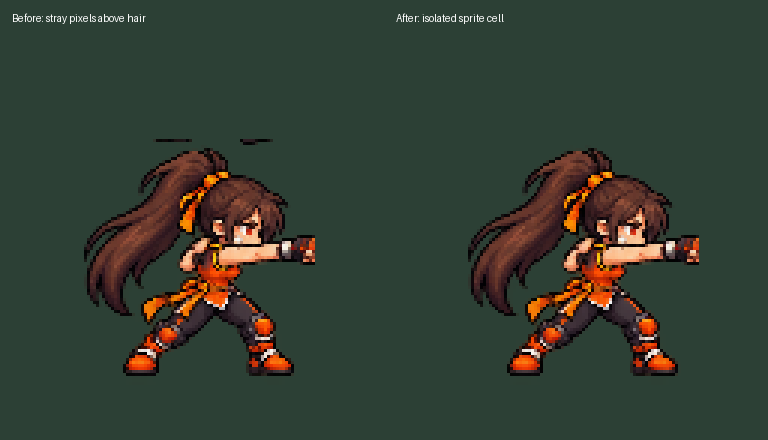

# Playable five-class art demo

Choose **Start → class → Enter dungeon**. **V** switches between two equipment appearances for the selected class. Existing movement, attack, skill, jump, dodge and pause controls remain unchanged.

| Class | Body reference | Separate equipment |
| --- | --- | --- |
| Slayer | Approved v6 | Steel / cyan sword |
| Gunner | Purple coat, silver hair, green goggles | Steel / cyan pistols, primary and offhand |
| Fighter | Orange training outfit, dark ponytail | Orange / blue gauntlets on both hands |
| Mage | Corrected v2: black hat, pinstriped coat, red hair | Green / violet orb staff |
| Priest | Corrected v2: dark hair/beard, asymmetric sleeves | Wood/gold / dark blue heavy cross |

The four non-Slayer body atlases have 24 frames: left idle/walk/attack and right idle/walk/attack, four frames each. Both facings have their own source cells. Runtime body cells are 128×128 with origin (64,112) and nearest filtering. The shared renderer is `game/character_visual.gd`; it selects class textures, hand anchors, weapon angles and equipment layer order. Gauntlets overlay body gloves; other equipment sits behind the grip hand.

Attack impact poses still start at the gameplay strike time (one third of attack duration). Projectile spawning, damage, range, launch, cooldown, collision and targeting remain unchanged. V is cosmetic, not an inventory or equipment-stats system.

## Generation and normalization

Built-in `image_gen.imagegen` generated four body sheets and one eight-item equipment sheet using the approved class concepts. Unmodified sources and exact prompts: [demo-source/manifest.json](demo-source/manifest.json). `tools/normalize-roster-demo.py` slices the grids with a shared transform per body sheet and nearest resizing. Runtime assets are in `assets/characters/` and `assets/weapons/`; concepts stay excluded by `.gdignore`.

[Atlas QA](demo-source/atlas-qa.json) verifies 512×768 transparent PNGs. [Equipment QA](demo-source/equipment-qa.json) verifies 48×96 textures; [cross QA](demo-source/cross-qa.json) verifies 64×96 cross textures.

## Sprite-cell cleanup

The older grid export included disconnected shoe/hair fragments from neighboring cells, visible as black strokes above some characters. Both normalization scripts now isolate the character from edge fragments before resizing, while retaining the main figure even when an attack hand touches a cell edge. Faint alpha bridges are separated so they cannot attach fragments to the next character's hair.

All five legacy atlases were regenerated. [Pixel-difference QA](sprite-cell-cleanup-qa.json) confirms that only stray pixels became transparent; all remaining pixels, cell sizes, scale and registration are identical. Equipment textures were preserved with the `--bodies-only` option. Five Python regression checks include the reported Fighter pose and faint-alpha/raised-hand cases. Run them with `python3 -m unittest discover -s tests/python -v` (requires Pillow).

Slayer now uses the newer six-frame chibi source through Start. All testing uses normal gameplay; separate Slayer demo entries have been removed. Original run and attack sequences are still pending action-definition extraction.

## Verification

- Native gameplay: 22 checks.
- Full roster combat: 69 checks.
- Art input, animation selection, facings, impact timing, swapping and pause: 57 checks.
- Godot project reference checker: zero errors/warnings.
- `tools/capture-roster-art.gd` captures each class's idle and both attack facings in the real renderer into ignored `build/`.
- Exported macOS app: `build/macos/Dungeon Fighter Arad.app`.
- macOS and Windows exports succeeded. macOS packaged startup checked headlessly; Windows runtime remains untested on this Mac.
- Real renderer inspection caught and corrected cross grip spacing, idle staff visibility and offhand gauntlet placement. Captures cover all five classes in idle and both attack facings.

## Current limits

This matches the first Slayer demo's level of detail. Dedicated run, jump, dodge, air, class-skill, hit and defeat strips remain future work. Those actions reuse the idle/walk/attack poses, jump offsets, modulation and still defeat fallback. Walk cycles and grip/foreground-hand layering still need refinement; the generated sources are prototype animation art. The goblin and effects retain primitives. The full animation plan remains in [animation-assets.md](animation-assets.md).
