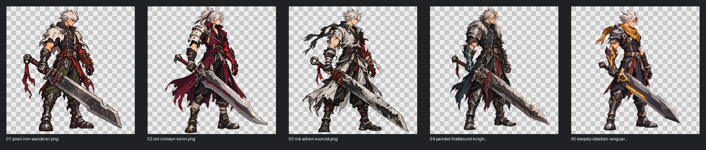

# Slayer redesign concepts

## Selected direction

Latest candidate: [revision 6](chibi-pixel-reference-v6.md), using the clearer full-body reference for cream spikes, navy side locks, glossy blue forehead guard, shoulder trim and green accents. Visual approval pending. Earlier revisions are history.

**Chibi pixel art with the original Slayer outfit**, approved on 2026-10-28. See [the selected style concept](chibi-pixel-original-look-v3.md) and [project art direction](../../../DESIGN.md#character-art-direction). The clearer reference supersedes earlier hair interpretations. Earlier alternatives below are exploration history.

Five alternative visual directions generated on 2026-10-28 with the built-in `image_gen.imagegen` tool. Full prompts and generation sources are recorded in `manifest.json`.

1. **Iron Wanderer:** pixel-inspired, ivory cape, iron cleaver, ember-bound arm.
2. **Crimson Ronin:** cel-shaded, burgundy wrap coat, asymmetric ivory armor.
3. **Ashen Exorcist:** textured ink, ash robes, vermilion curse, ring-pommel sword.
4. **Frostbound Knight:** painted steel, teal coat, fur mantle, cyan curse.
5. **Obsidian Vanguard:** faceted low-poly appearance, ochre scarf, amber blade.

## Game frame

- Godot 4.7, GL Compatibility; 1280 × 720 viewport.
- Side-view ground-plane brawler. Existing characters are drawn with primitives.
- These are single-pose concept alternatives awaiting selection, not animation sheets or integrated gameplay assets.
- User-provided Slayer screenshot served as an archetype reference. Original screenshot is not bundled. Costumes and weapons were redesigned.

## Technical review

- All five source PNGs are 1233 × 1275 RGBA with verified transparent pixels.
- Source images are preserved unchanged, including embedded provenance metadata.
- Comparison sheet uses nearest-neighbor scaling over a checkerboard.
- Pixel direction is a generated draft: its grid and palette are not production pixel art.
- Fine texture and costume details need simplification at gameplay scale. Verify padded edges, consistent pivots and animation proportions after selecting a direction.
- The original-outfit chibi pixel revision is the approved style and outfit; these five earlier alternatives were not selected. No in-engine review performed. Runtime art is unchanged.
- `.gdignore` excludes this concept directory from Godot asset imports.

## Next production step

Correct the hairstyle, establish the final sprite size and baseline, then create consistent idle, movement, attack, jump, dodge and hit frames. Import and validate the selected character in the arena before treating it as production-ready.
