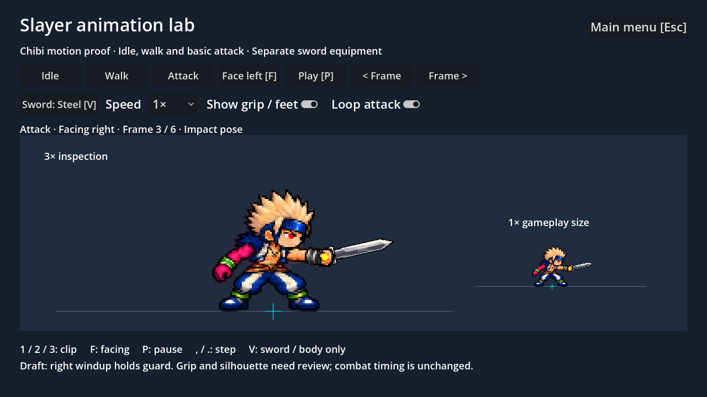

# Slayer chibi animation proof

A separate **Slayer animation lab** on the main menu previews recreated chibi idle, walk and basic attack animations. The decoded DFO art was used to study poses, weight shifts and layering; its sprites are not the lab's runtime artwork. Approved Slayer v6 remains the costume/proportion reference.



Paired-facing captures: [idle](idle-preview.gif), [walk](walk-preview.gif), [attack](attack-preview.gif). These use the lab timing; they are visual-review clips, not recorded gameplay.

## Test on your Mac

In your existing DFA checkout:

```sh
git fetch origin
git switch dfo-character-animations
```

Open `project.godot` in Godot, press **F5**, then choose **Slayer animation lab**. The previous Slayer art demo still enters the unchanged combat arena.

1. Press **1**, **2**, **3** to review idle, walk and basic attack.
2. Press **F** to compare independently authored left/right views. The magenta arm must stay anatomically left; the normal braced right hand holds the sword.
3. Choose **0.25×**, then press **P** to pause. Use **,** / **.** or the frame buttons to inspect each pose. Stepping pauses playback; **P** resumes.
4. Press **V** to cycle Steel, Cyan and Body only. Check the sword stays attached to the normal hand and the body art does not change when swapping equipment.
5. Enable **Show grip / feet**. Yellow marks the authored hand anchor; cyan marks the foot origin. Check for visible grip gaps, floating soles, size changes and costume/arm changes across frames.
6. Turn off **Loop attack** to inspect the recovery hold. Reselect Attack or turn looping on to restart. **Esc** returns to the main menu.

The large view is 3× inspection scale; the small view is 1× gameplay size. Check both: an enlarged frame can conceal readability problems at game scale. Current acceptance is a style/motion proof, not final production approval.

## Scope and known limits

- Six clips, 36 registered 128×128 cells: six idle/walk/attack frames for each facing. One source scale of 0.4; frames are translated to a common foot baseline, not independently resized.
- New body art was generated using `image_gen.imagegen`, then sliced and registered. Source images, complete prompts and provenance are preserved here. Runtime atlas, timing, grips and registration live in `assets/characters/slayer/animation-proof/`.
- Walk poses now alternate legs/arms. Idle differences remain subtle. Artwork still needs pixel-grid/palette and motion polish.
- Generated right overhead windup had swapped cursed-arm anatomy. That cell is deliberately excluded; right attack frame 2 holds the guard pose. The left attack retains its overhead pose. Do not treat the two facings as a finished, matching sword technique.
- Weapon grips and angles are authored for these normalized cells. Weapons remain separate; body fingers cover the grip. Dedicated foreground hands, per-pose occlusion, full swing arcs and grip cleanup remain unfinished.
- Attack timing is a provisional 0.6-second clip, entering impact at 0.2 seconds (one third). This visual-only lab does not change actual damage, hit windows, collision, movement or existing gameplay rendering.
- Run, jump, dodge, skills, hit, defeat and the other four classes have not been recreated in this proof. Original Mage/Priest weapon mapping remains separate extraction work.

## Verification

Tested with Godot **4.6.3** in this cloud workspace (the repository's documented development version is 4.7.2). Editor import and real OpenGL rendering succeeded. Captured all 36 lab frames; inspected impact poses in both facings, idle/walk grips and the left overhead pose. A small right-walk grip offset was corrected during this review.

- Animation lab: **24 checks passed** (controls, freeze/step, facings, equipment isolation, impact boundary, recovery, main-menu return and unchanged gameplay entry).
- Existing demo / roster / art / dungeon suites: **487 checks passed**.
- macOS resource-pack export succeeded; the 24 lab checks also passed when run against the exported pack, including runtime JSON loading. This does not constitute a macOS application-bundle export or a physical Mac test.

```sh
godot --headless --path . --editor --import --quit
godot --headless --path . --script res://tests/native/animation_lab_test.gd
```

Rebuild the atlas with Python 3 and Pillow:

```sh
python3 tools/normalize-slayer-animation-proof.py
```

For real-renderer captures (requires a graphical display):

```sh
mkdir -p build
godot --path . --script res://tools/capture-animation-lab.gd
```
