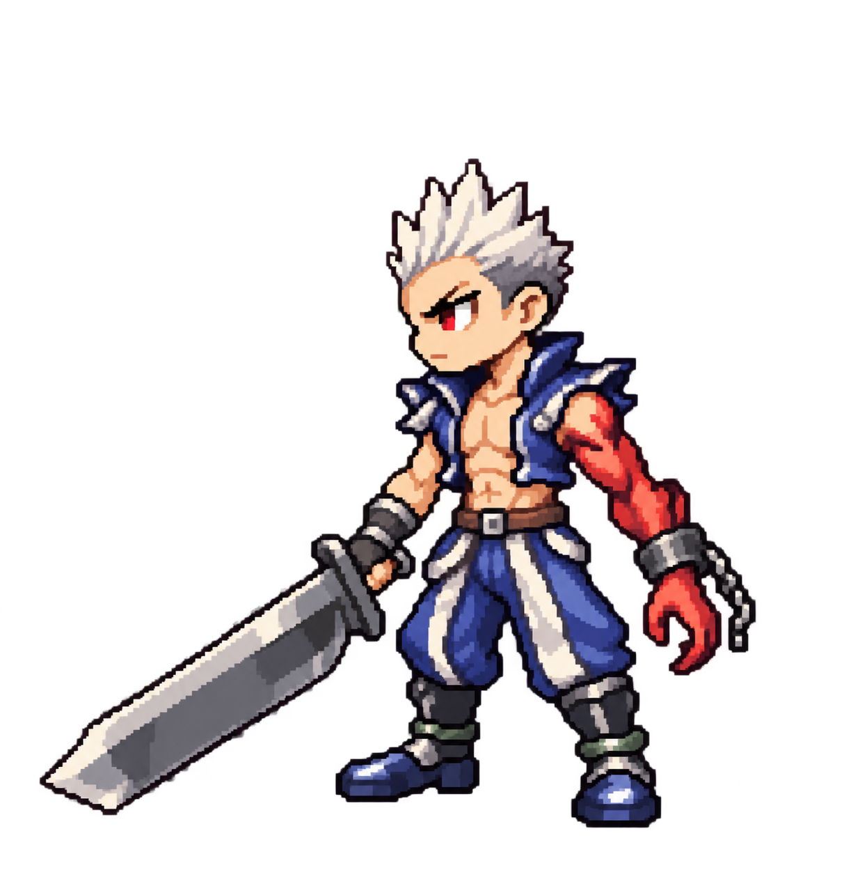

# Slayer hairstyle correction, revision 4

Chibi pixel style and original outfit remain approved. This revision narrows the hair silhouette and replaces the broad backward sweep with a compact upright crown. Hairstyle approval remains pending user review.

Generated using built-in `image_gen.imagegen` on 2026-10-28 from the v3 concept and original screenshot. Anatomical left cursed arm and right sword hand retained. Single-pose concept; runtime unchanged.

## Prompt

Edit image 1, approved blue-outfit chibi pixel Slayer. Change ONLY hairstyle. Image 2 is original gameplay screenshot and hairstyle ground truth. Current hair in image 1 is too wide, too long, and swept sideways/backward like a fan. Replace it with the original Slayer's SHORT VERTICAL SPIKY WHITE HAIR: a narrow compact tufted crown, tallest spikes pointing STRAIGHT UP, about 5 small pointed tufts, short side hair above ears, subtle dark gray roots. Dramatically reduce backward horizontal projection and shorten upper hair length about 40%. Hair width should stay within head width; no horizontal swept-back fan, no long mane, no undercut pompadour, no side-swept bangs. Exposed forehead retained. Replicate the compact upright silhouette visible in screenshot, adapted to chibi head size. Preserve everything else exactly: pixel-art rendering, face and eyes, body size, blue open vest, bare chest, blue-and-white trousers, boots, sword, pose and transparency. Anatomical LEFT arm remains red and shackled on near side, viewer RIGHT, normal right hand holds sword viewer LEFT. No mirroring. Entire single character and sword in frame, no text or scenery.
