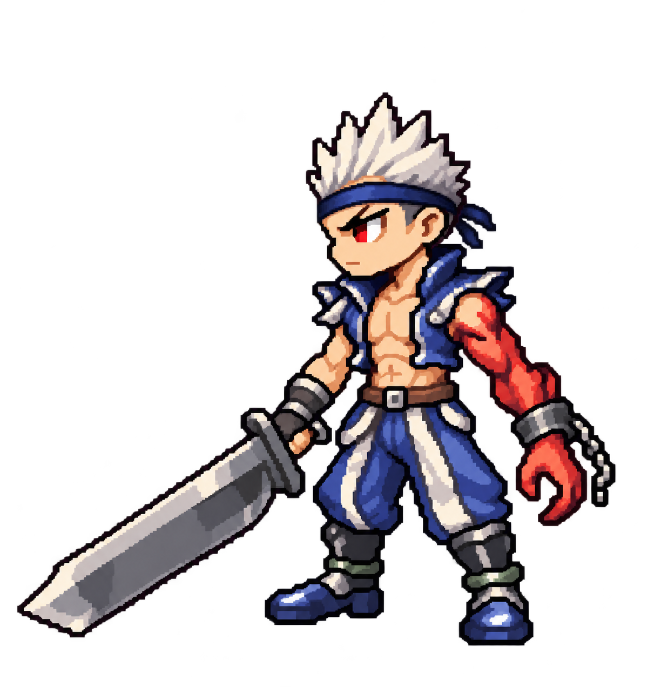

# Slayer headband correction, revision 5

User correction: original Slayer wears a headband. Preserve this feature in future artwork.

Reference reinspection: the screenshot shows a dark forehead band with a blue-gray front highlight and a compact crown of pale ivory spikes. Revision 5 exaggerates hair height and adds trailing ties that the screenshot does not establish. Do not treat those additions as reference-accurate. No emblem or metal plate can be confirmed at this resolution.

Added a dark blue forehead headband beneath the short upright white spikes. Retained chibi pixel direction, original outfit, anatomical left cursed arm and right sword hand. Visual revision awaits user review; runtime unchanged.

Generated with built-in `image_gen.imagegen` on 2026-10-28, using revision 4 and the original screenshot as references. Transparent concept; not a production animation sprite.

## Prompt

Edit image 1, the latest chibi pixel Slayer. Add the missing HEADBAND worn by original Slayer in reference image 2. Headband is a simple narrow dark blue cloth band wrapping horizontally around the forehead directly beneath the upright white hairline, passing above both eyebrows and around temples. Clearly visible navy band against forehead; simple pixel cloth texture, tiny lighter blue highlight, no metal plate, no logo. Small tied ends behind head only if visible naturally. Use screenshot as headband reference. Preserve upright short white spiky hairstyle and all other design details exactly: same chibi pixel art, face, eyes, blue open vest, bare torso, blue-white trousers, armored boots, sword, pose, transparent background. Anatomical LEFT cursed red arm with cuff and chain stays viewer RIGHT; normal RIGHT hand holding sword stays viewer LEFT. Do not mirror. No other outfit changes, no extra accessories. One full-body character, complete sword in frame, comfortable transparent padding. No text, no scene, no ground shadow.
