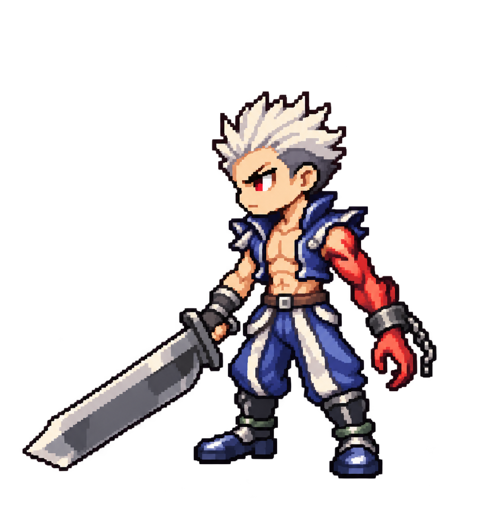

# Chibi pixel Slayer: original outfit, revision 3

Approved style and outfit on 2026-10-28: retain the chibi pixel appearance and follow the original game character's look. Hairstyle requires correction: shorter, tighter upright spikes matching the original screenshot, rather than the current broad swept-back crest.

Visual locks: upright white spikes; blue sleeveless open vest and exposed torso; blue-and-white trousers; armored boots; broad steel sword in right hand; cursed red anatomical left arm with metal cuff and chain. Facing screen left exposes the left arm.

Generated with built-in `image_gen.imagegen` on 2026-10-28 using the v2 concept and user-provided original screenshot. No original screenshot bundled. Single transparent concept pose; not yet a grid-normalized or animated gameplay asset. Style and outfit approved; hairstyle and production readiness pending. Runtime unchanged.

## Prompt

Edit reference image 1, the approved CHIBI PIXEL Slayer concept, to wear the ORIGINAL GAME SLAYER LOOK shown in reference image 2, the original gameplay screenshot. Image 1 is the edit target. Image 2 is the costume, hair and sword reference. Keep image 1's chibi proportions, compact size, pixel rendering, serious face, short upright white hair, same screen-left facing pose, same transparent background. Change costume and equipment to recognizable base Slayer appearance from image 2.
OUTFIT: REMOVE the burgundy scarf completely. REMOVE the closed charcoal shirt. Replace with a short cobalt/navy BLUE SLEEVELESS OPEN VEST, raised blue collar, angular small shoulder flaps, exposed athletic bare chest and abdomen between vest halves. Simple brown belt at waist with small pale metal buckle. Loose blue pants with prominent pale ivory/white vertical side panels or hanging split cloth strips, based on screenshot. Dark knee/shin guards and dark navy armored boots with small steel highlights. A plain compact wrist/forearm guard on normal arm. Do not retain the previous burgundy scarf, gray jumpsuit or maroon accents.
LEFT ARM: Anatomical LEFT arm is cursed, anatomical RIGHT arm normal. Keep image 1's left arm on the near side, viewer RIGHT of torso, and right hand holding sword on far side, viewer LEFT. Make cursed left arm closer to original Slayer: RED-SKINNED HUMAN ARM with normal humanoid hand, dark metal cuff/shackle and a short attached chain; restrain the large monstrous claw shape and remove glowing lava cracks. Red curse remains recognizable. No swapped arms, no mirroring. The left red hand is free; normal right hand holds sword.
WEAPON: match screenshot's simple broad straight steel sword with dark hilt and plain compact guard. Large heavy silver-gray blade, subtle bevel, square-ish broad profile with angled pointed tip, NO ornate decorations, NO jagged fantasy demon sword. Keep held diagonally down toward screen left.
HAIR: preserve revised short upright ivory-white spiky crop, darker underside, exposed forehead. Do not add long bangs or ponytail.
PIXEL ART: preserve chibi 2.5-head body proportions and crisp coarse square pixel clusters, stepped contours, limited palette aesthetic, flat 2-3 tone material shading. Full body and entire sword fit with transparent margins. One single character only, orthographic side-view gameplay idle. Genuine transparency. No text, labels, panels, scenery, floor or shadow.
