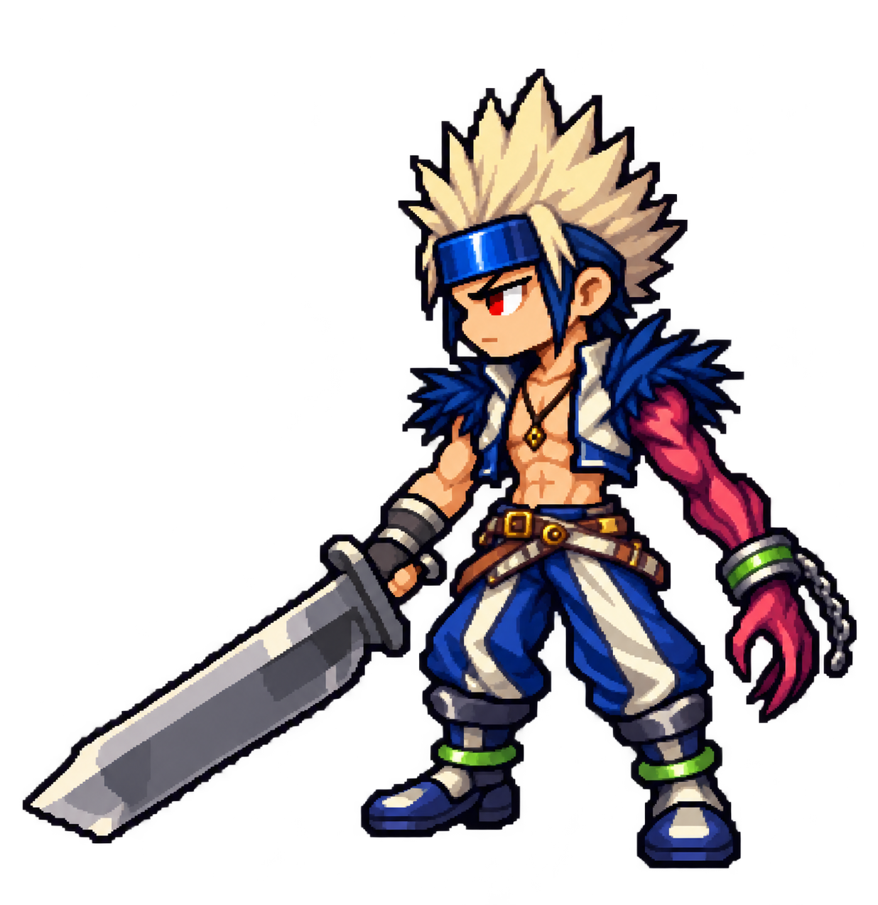

# Slayer clear-reference revision 6

Accepted by the user as the visual style reference on 2026-10-28; used to generate the other class concepts. This is concept approval, not production-sprite validation.

Generated with built-in `image_gen.imagegen` on 2026-10-28 from revision 5 and the user's clearer full-body Slayer artwork. The artwork is the authoritative appearance reference; previous compact-white-hair and plain-band interpretations were superseded.

Changes: cream-blond vertical spikes, navy side locks, glossy blue forehead guard, navy shoulder trim, ivory lapels, pendant, green cuff and ankle accents, crimson-magenta anatomical left arm. Chibi pixel direction and original outfit remain approved; this candidate awaits visual approval. Single transparent concept, not a production animation sprite. Runtime unchanged.

## Prompt

Edit image 1 (our chibi pixel Slayer) using image 2 (clear original Slayer full-body artwork) as the authoritative design reference. Preserve image 1's compact chibi pixel proportions, single idle pose, leftward three-quarter side facing, big head, short legs, chunky boots, broad sword, crisp pixel clusters and transparent background. Correct recognizable design details to image 2; do not recreate its tall body, raised-arm pose, scene, platform or illustration rendering.
PRIMARY CORRECTION HAIR AND HEADGEAR: Original hair is pale CREAM BLOND, not pure white. Tall thin angular spikes stand VERTICALLY UP in a narrow jagged crown, some shorter points fan sideways at the base. Include the distinctive LONG DARK NAVY SIDE LOCKS framing the cheeks below the headband, as in image 2. The forehead accessory is a wide rectangular COBALT BLUE glossy forehead guard with dark border and a bright blue reflection at front; it sits LOW across forehead just above eyes. Not a plain tied cloth band. Remove the trailing ribbon ties invented in image 1. No emblem invented on blue guard. Preserve serious chibi face with eye visible just beneath guard.
SECONDARY REFERENCE DETAILS: dark navy spiky FEATHER-LIKE shoulder trims on cropped open blue vest, ivory lapels, bare torso, a simple dark necklace with small gold pendant. Blue loose trousers with large ivory diagonal panels, brown belts with small gold buckle. Dark boots with ivory shin panels and GREEN ankle rings. Cursed anatomical LEFT arm is dark crimson-magenta/purple rather than glowing lava red, humanlike slender claw fingers, metallic cuff with GREEN inset band and short hanging chain. Normal RIGHT arm has a gray forearm bracer and holds simple broad dark steel sword. Keep costume details simplified to readable few pixels rather than detailed realism.
ANATOMY LOCK: cursed anatomical LEFT arm is near arm on viewer RIGHT, free hand down; normal anatomical RIGHT hand holds sword on viewer LEFT. Do NOT swap arms or horizontally mirror. Do not adopt raised hand pose from image 2. Feet baseline and proportions remain image 1.
Full body and complete sword inside frame with ample transparent padding. One character, one sword, one pose. Genuine transparent background, no shadows, labels, lettering, duplicate characters, environment or platform. Pixel art, not smooth anime illustration.
