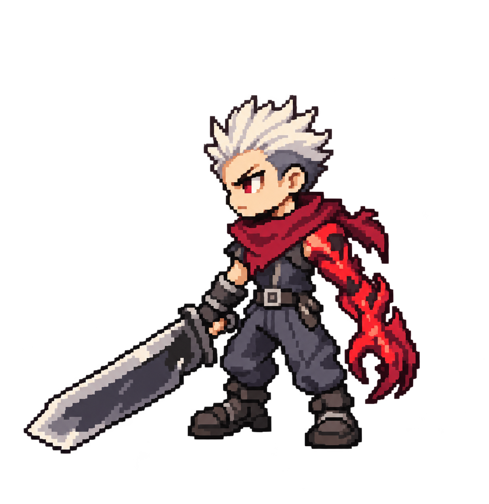

# Chibi pixel Slayer, revision 2

User direction: chibi proportions from option 2, pixel-art rendering, anatomical left cursed arm, hair matching the original Slayer reference.

Design locks: short upright white spikes with an exposed forehead; left arm cursed, right hand holds sword; compact body, short legs, burgundy scarf and charcoal clothing.

Generated with built-in `image_gen.imagegen` on 2026-10-28. Transparent single-pose concept; not an approved animation sprite or grid-normalized production pixel asset. Facing left exposes the anatomical left arm. Right-facing frames will need separate anatomy checks rather than a simple mirror.

## Initial prompt

Create ONE revised original Slayer game character concept as CHIBI PIXEL ART. Reference image 1 is the original tiny Slayer screenshot, used specifically for HAIRSTYLE: short stiff upright ivory-white spiky hair, compact crown of pointed vertical tufts swept slightly back, dark roots/underside. NO long hair, NO ponytail, NO broad side-swept fringe covering an eye, NO huge fluffy round anime hair. Reference image 2 is the previous five-style board: use ONLY character #2 (second panel) for its cute fierce chibi proportions and maroon scarf costume direction. Ignore the other four characters and all board typography.
CRITICAL ANATOMY: the character's ANATOMICAL LEFT ARM is cursed, NOT the right arm. The RIGHT ARM is normal and holds the sword. Show the character facing toward SCREEN LEFT in a three-quarter SIDE gameplay view so his anatomical LEFT shoulder and cursed LEFT arm are the NEAR arm, clearly visible on the viewer's right side of his torso. Red demonic LEFT forearm and LEFT claw hang free on the near side, no sword in cursed hand. Normal RIGHT arm is the far arm and holds ONE oversized steel sword pointed diagonally downward toward SCREEN LEFT. Cursed arm must visibly connect to his LEFT shoulder. No mirrored anatomy. One normal arm plus one cursed left arm.
Art style: deliberately coarse old-school pixel sprite with real-looking crisp square pixel clusters, hard stepped edges, 16 to 24 color aesthetic, only 2-3 shades per material, no smooth outlines, no painterly textures, no airbrushed gradients. Design on an approximately 64x64 logical pixel grid with character about 48 pixels tall, enlarged at integer scale with nearest-neighbor appearance. This is pixel CHIBI, about 2.5 heads tall, large expressive head, compact torso, short legs, chunky boots. Face has tiny serious eyes and a scowl with minimal pixels. Short stiff white upright hair must match original screenshot's silhouette. Original revamped costume: short burgundy scarf around neck, closed charcoal tunic, simple gray trousers, dark boots, one belt. Costume simple enough for animation. Anatomical LEFT cursed arm saturated dark red with a few brighter red pixels, slightly enlarged claw. Normal RIGHT hand holds large broad straight steel sword with simple dark grip. Keep eyes visible. Adult fantasy swordsman represented in cute chibi proportions, not a realistic person.
Technical output: single full-body isolated sprite, genuine transparent background, no ground shadow, NO background checkerboard baked in, NO labels, NO text, NO panels, NO UI, NO duplicates, no extra weapons. Whole body, hair and sword fit inside frame with generous transparent margins. Clearly separated sword, body and cursed hand. Upper-left lighting. Flat orthographic gameplay framing.

## Hair correction prompt

Edit image 1, the chibi pixel swordsman. Change ONLY HIS HAIR to match hairstyle in image 2, the original Slayer screenshot. Hair must be a SHORT UPRIGHT SPIKY CROP: exposed forehead and both eyebrows, compact dark gray undercut at temples and back, ivory white spikes clustered vertically upward at crown, tips leaning back toward SCREEN RIGHT. Remove ALL long hanging white bangs over forehead, ALL eye-covering fringe and ALL side locks. Front hairline above eyebrows, forehead fully visible. Reduce hair mass by about 35 percent; short vertical flame-like spikes, not a giant fluffy mane. Keep face, head size, expression, body, costume, burgundy scarf, sword, pose, pixel rendering and transparent background unchanged. CRITICAL preserve anatomical LEFT cursed red arm on the near side (viewer right), normal RIGHT hand gripping sword on far side (viewer left). No mirroring. Keep crisp square pixel clusters. Whole character and sword visible. One character, no labels or text.
