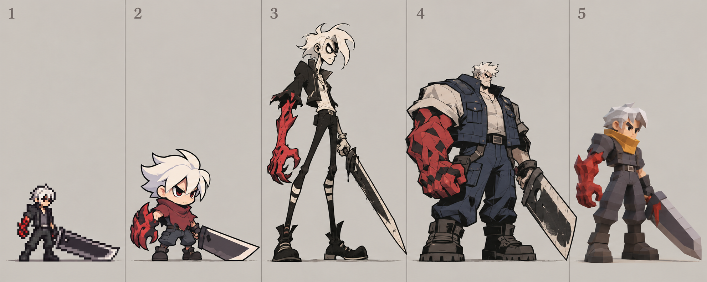

# Slayer style and size exploration

Generated with built-in `image_gen.imagegen`, 2026-10-28.

Core traits: white hair, oversized sword, cursed red forearm, defiant swordfighter attitude. Style, costume and body proportions are open to redesign.

1. Tiny pixel sprite.
2. Chibi flat cartoon.
3. Lanky gothic cartoon.
4. Bulky graphic brawler.
5. Compact low-poly 3D.

Concept board only; relative heights explore proportions, not final engine sprite dimensions. No direction approved or integrated.

## Prompt

Create a single landscape character art exploration board with FIVE radically different ORIGINAL redesigns of a Slayer swordsman, presented in five equal vertical panels left to right. This is a game art style and body-proportion exploration, NOT five costumes in one anime rendering style. ONLY core traits survive: white or silver hair, one oversized sword, one cursed red forearm, defiant swordfighter attitude. Change face, costume, proportions, rendering medium and character size dramatically. Do not reproduce the original DFO costume. No realistic ornate anime hero illustrations. Each design full-body, side-facing three-quarter gameplay idle, facing right, entire weapon visible. Each occupies its own panel without overlap. Neutral light warm-gray background. Shared feet baseline near bottom; DIFFERENT body heights intentionally visible, no equalizing character size. Crisp minimal board with small labels 1, 2, 3, 4, 5 and no other text.
Panel 1: TINY RETRO PIXEL SPRITE, about 48 native pixels tall shown at crisp nearest-neighbor enlargement; 3 heads tall, visible coarse square pixels, only 12 palette colors, simple dark jacket and trousers, huge rectangular sword, red cursed arm. Smallest body, about 40% panel height, no anti-aliasing.
Panel 2: CHIBI FLAT VECTOR-LOOK game art, 2 heads tall, oversized round head, small body and stubby legs, bold smooth black outlines, white hair formed as three big tufts, maroon poncho, giant blunt triangular sword, red oversized claw arm. About 50% panel height, adorable but fierce. Flat solid colors, no realistic textures.
Panel 3: LANKY RUBBER-HOSE GOTHIC CARTOON, 5 heads tall, narrow long limbs, angular crooked white hair, cropped black coat and striped stockings, elongated thin sword, enlarged red demon fist. About 85% panel height, hand-drawn expressive irregular ink contours, desaturated cream and black with red accent. Distinct adult cartoon face, not anime.
Panel 4: BULKY GRAPHIC BRAWLER, 2.5 heads tall, enormous shoulder width and fists, tiny white-haired head, massive boots, blocky navy work vest over closed shirt, red stone-like cursed arm, absurdly broad cleaver sword. About 70% panel height and widest silhouette, heavy comic outlines, only three flat shadow tones, punchy screen-print graphics, no tiny detailing.
Panel 5: COMPACT TOY-LIKE LOW-POLY 3D, 3 heads tall, rounded-square silver hair, simple charcoal jumpsuit with ochre scarf, red crystalline arm, thick geometric sword, broad hands and boots. About 60% panel height, orthographic shaded low-poly render with actual visible facets, soft ambient light, no fine textures.
Keep all five visually unmistakably different in medium and silhouette. Large negative space above shorter characters is intentional. No environment, no extra characters, no ornate armor, no intricate belts, no watermark.
